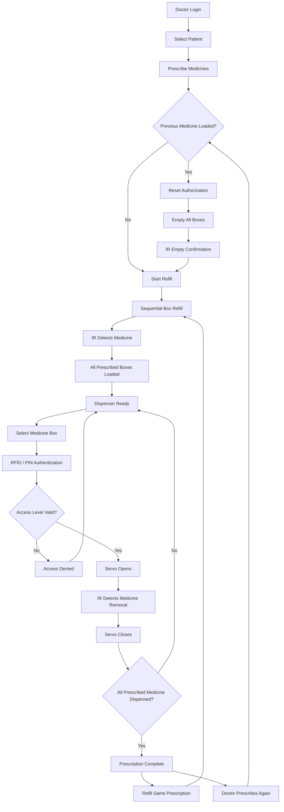
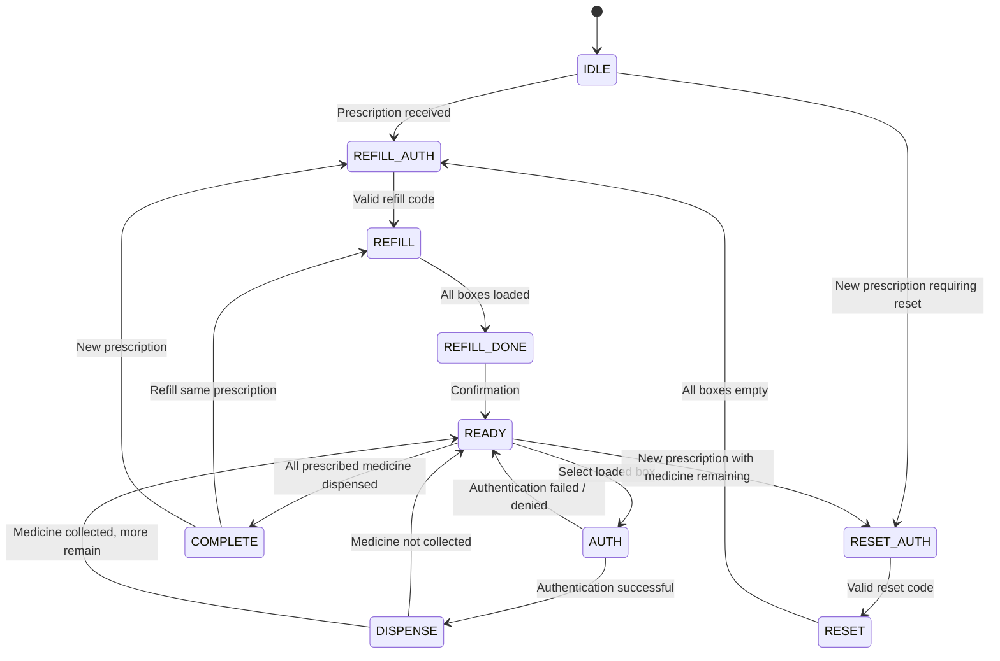

# MediDispense

[](https://www.arduino.cc/en/software)
[](https://www.raspberrypi.com/products/raspberry-pi-pico/)
[](./Medicine_Dispenser6.2.ino)
[](./MediDispense_GUI.html)
[](./LICENSE)

**MediDispense is a Raspberry Pi Pico W-based smart medicine dispensing system with RFID/PIN authentication, three severity-based medicine compartments, IR-based dispensing verification, and a browser-based doctor console.**

---

## 1. Overview

### The Problem

Medication dispensing in hospitals and healthcare environments requires proper access control, prescription management, and verification that the intended medicine has actually been collected.

Manual dispensing can introduce problems such as:
- Unauthorized access to restricted medication.
- Incorrect medicine selection.
- Difficulty monitoring dispensing activity.
- Lack of confirmation that medicine has been collected.
- Limited visibility of the dispensing process for healthcare personnel.

### The Solution

MediDispense combines an embedded medicine dispenser with a browser-based doctor console.

The Raspberry Pi Pico W controls three medicine compartments, manages authentication, operates servo motors, monitors IR sensors, and communicates with the doctor console through USB Serial.

The doctor console allows authorized doctors to manage patients, prescribe medicines, monitor dispensing progress, and review activity.

### System Workflow

The system follows a prescription-driven workflow.

1. **Prescribe:** The doctor logs into the browser console and assigns medicines to the three severity levels for a patient.
2. **Reset (when required):** If medicine from a previous prescription remains loaded, the dispenser enters reset mode. The refill/reset code must be entered, and all boxes must be emptied.
3. **Refill:** The dispenser opens the prescribed compartments sequentially. The operator loads the appropriate medicine, and IR sensors detect its presence.
4. **Ready:** Once all prescribed compartments are loaded, the dispenser becomes ready for patient access.
5. **Dispense:** The patient selects a compartment and authenticates using an RFID card or PIN. The firmware checks the user's access level before opening the compartment.
6. **Complete:** The IR sensor detects when the medicine has been removed. The compartment closes after the configured delay, and the dispensing record is updated.
7. **Reset:** After dispensing is complete, the same prescription can be refilled using the refill code, or the doctor can submit another prescription.

### Workflow Diagram



---

## 2. Features

### 2.1 Three Severity-Based Medicine Compartments

The dispenser has three independently controlled medicine boxes.

| Box | Severity | Access Level |
|---|---|---|
| Box 1 | General | Level 1 |
| Box 2 | Severe | Level 2 |
| Box 3 | High Severity | Level 3 |

Each box has:
- An independently controlled servo motor.
- An individual IR sensor.
- Prescription-based medicine assignment.
- Individual loading and dispensing status.

A user can access a box only if their assigned access level is equal to or higher than the box level.

### 2.2 RFID and PIN Authentication

Two authentication methods are implemented:

- RFID authentication using the MFRC522 reader.
- Four-digit PIN authentication using the matrix keypad.

The firmware also accepts a PIN through the serial interface while in the authentication state.

### 2.3 Role-Based Access Control

The firmware maintains a user registry containing:
- User name.
- PIN.
- RFID UID.
- Maximum permitted severity level.
- Doctor prescription permission.

### 2.4 Failed Login Protection

The firmware implements:
- Three maximum failed attempts.
- A 10-second lockout after the maximum attempts are reached.
- Failed authentication logging.
- Access-denied handling when a valid user attempts to access a higher-level compartment.

### 2.5 IR-Based Medicine Confirmation

Each compartment has an IR sensor.

The sensors are used for:
- Detecting medicine during refill.
- Confirming that medicine has been removed during dispensing.
- Determining when a compartment should close.
- Confirming that all compartments are empty during reset.

IR readings use an 80 ms debounce interval.

### 2.6 Automatic Start-Up Self-Check

At startup, the firmware checks:
- LCD detection through I2C.
- RFID reader detection through SPI.
- Keypad stuck-key condition.
- Initial IR sensor readings.
- Servo movement.

The servo test performs a small movement so that it can be visually observed. The firmware does not have servo-position feedback.

### 2.7 Doctor Session Timeout

The doctor console session expires after 15 minutes of inactivity.

The firmware also maintains a separate 30-second inactivity timeout for the dispenser's authentication screen.

### 2.8 Live LCD Mirror

The browser GUI displays a representation of the dispenser's 16x2 LCD.

LCD updates are transmitted through the serial event system and reflected in the GUI.

### 2.9 Activity Log and CSV Export

The GUI provides an activity log for events such as:
- Doctor login and logout.
- Prescription submission.
- Medicine loading.
- Authentication success and failure.
- Access denial.
- Medicine dispensing.
- Prescription completion.
- Reset and refill operations.
- Connection and start-up check results.

The GUI supports CSV export of its activity log.

The browser-side activity log retains up to 300 entries.

### 2.10 Demo Mode

The GUI includes a built-in simulator that works without physical hardware.

Demo mode provides:
- Simulated keypad.
- Simulated RFID cards.
- Simulated IR sensor inputs.
- Simulated compartment operation.
- Simulated prescription and dispensing workflow.
- Simulated LCD updates.

Demo mode is intended for interface testing and workflow demonstration. It does not operate the physical hardware.

---

## 3. Hardware Requirements

The following components are referenced by the firmware.

| Component | Quantity | Purpose |
|---|---:|---|
| Raspberry Pi Pico W | 1 | Main controller |
| 4x4 Matrix Keypad | 1 | Local PIN input and box selection |
| MFRC522 RFID Reader | 1 | RFID authentication |
| RFID Cards/Tags | As required | User identification |
| 16x2 I2C LCD | 1 | Local system display |
| Servo Motors | 3 | Independent compartment control |
| IR Sensors | 3 | Medicine presence detection |

### Hardware Notes

- The RFID module is configured for 3.3V operation.
- The LCD I2C address is configured as `0x27`. Change it to `0x3F` if required by the actual display.
- IR sensor polarity is configurable through `IR_ACTIVE_LOW`.
- The default firmware configuration uses `IR_ACTIVE_LOW 0`.

---

## 4. Wiring Configuration

The following GPIO assignments are taken directly from the wiring summary in `Medicine_Dispenser6.2.ino`.

### 4.1 Keypad Connections

| Keypad Pin | Pico W GPIO | Physical Pin |
|---|---|---:|
| R1 | GP0 | 1 |
| R2 | GP1 | 2 |
| R3 | GP2 | 4 |
| R4 | GP3 | 5 |
| C1 | GP12 | 16 |
| C2 | GP13 | 17 |
| C3 | GP14 | 19 |
| C4 | GP15 | 20 |

### 4.2 RFID Reader (MFRC522)

The RFID reader uses SPI0.

| MFRC522 Pin | Pico W GPIO | Physical Pin |
|---|---|---:|
| MISO | GP4 | 6 |
| SDA / SS | GP5 | 7 |
| SCK | GP6 | 9 |
| MOSI | GP7 | 10 |
| RST | GP28 | 34 |
| VCC | 3V3 | 36 |
| GND | GND | GND |

**Important:** The MFRC522 must be supplied with 3.3V. Do not connect its VCC to 5V.

### 4.3 LCD (I2C)

The LCD uses I2C0.

| LCD Pin | Pico W GPIO | Physical Pin |
|---|---|---:|
| SDA | GP8 | 11 |
| SCL | GP9 | 12 |
| VCC | As required by the LCD module | — |
| GND | GND | GND |

Configured I2C address: `0x27`.

### 4.4 Servo Motors

| Servo | Controlled Compartment | Pico W GPIO | Physical Pin |
|---|---|---|---:|
| Servo 1 | General | GP16 | 21 |
| Servo 2 | Severe | GP17 | 22 |
| Servo 3 | High Severity | GP18 | 24 |

Firmware servo positions:

| Setting | Value |
|---|---:|
| Closed position | 0° |
| Open position | 180° |
| Minimum pulse width | 500 µs |
| Maximum pulse width | 2500 µs |

### 4.5 IR Sensors

| IR Sensor | Compartment | Pico W GPIO | Physical Pin |
|---|---|---|---:|
| IR 1 | General | GP19 | 25 |
| IR 2 | Severe | GP20 | 26 |
| IR 3 | High Severity | GP21 | 27 |

---

## 5. Software Architecture

The firmware uses object-oriented programming, custom data structures, and several software design patterns to organize hardware control, authentication, event handling, and dispensing operations.

### 5.1 Design Patterns

| Design Pattern | Implementation | Purpose |
|---|---|---|
| State | `DispenserState` and derived state classes | Separates dispenser behaviour into operational states |
| Singleton | `Dispenser::instance()` | Provides one dispenser controller instance |
| Observer | `EventBus`, `EventListener`, `SerialReporter` | Publishes firmware events to the serial interface |
| Strategy | `Authenticator`, `PinAuthenticator`, `RfidAuthenticator` | Supports interchangeable authentication methods |
| Factory | `UserFactory` | Creates user objects from configuration records |

The code also uses a Facade-style controller interface through the `Dispenser` class and a Template Method structure for shared code-entry handling.

### 5.2 Custom Data Structures

The firmware implements its own data structures rather than relying exclusively on standard container classes.

| Data Structure | Implementation | Usage |
|---|---|---|
| Stack | `PinStack` | Stores PIN and refill-code digits |
| Queue | `Queue<T>` | Processes input events and refill box order |
| Singly Linked List | `UserRegistry` | Maintains registered users |
| Doubly Linked List | `AccessHistory` | Maintains access history |
| Singly Linked List | `EventBus` | Maintains event listeners |

Important capacities:

- PIN stack: 4 digits.
- Input queue: 16 events.
- Access history: 20 firmware records.
- Number of medicine boxes: 3.

### 5.3 State Machine

The firmware implements separate state classes for the major operating phases.

| State | Description |
|---|---|
| `IDLE` | Waiting for a prescription |
| `REFILL_AUTH` | Waiting for refill authorization |
| `REFILL` | Opening prescribed boxes sequentially for loading |
| `REFILL_DONE` | Refill completion confirmation |
| `READY` | Waiting for box selection |
| `AUTH` | Waiting for RFID or PIN authentication |
| `DISPENSE` | Compartment open for medicine collection |
| `RESET_AUTH` | Waiting for reset authorization |
| `RESET` | All compartments open until empty |
| `COMPLETE` | All prescribed medicines have been dispensed |



The exact transitions are controlled by the firmware state implementations and prescription conditions.

---

## 6. Serial Communication Protocol

The Pico W communicates with the browser-based doctor console over USB Serial.

| Parameter | Configuration |
|---|---|
| Communication | USB Serial |
| Baud rate | 115200 |
| Command termination | Newline or carriage return |
| Command buffer | 120 characters |

### 6.1 PC-to-Dispenser Commands

The firmware recognizes the following commands.

| Command | Format | Description |
|---|---|---|
| HELLO | `HELLO` | Requests firmware information, box names, and role information |
| STATUS | `STATUS` | Requests current dispenser status |
| PING | `PING` | Checks communication |
| HISTORY | `HISTORY` | Requests firmware access history |
| SELECT | `SELECT <box>` | Selects a compartment |
| PIN | `PIN <pin>` | Submits a PIN during authentication |
| CLEAR | `CLEAR` | Clears the current PIN input |
| EXIT | `EXIT` | Exits the current authentication screen |
| DOCLOGIN | `DOCLOGIN <pin>` | Authenticates a doctor |
| DOCLOGOUT | `DOCLOGOUT` | Ends the doctor session |
| RX | `RX <patient>\|<m1>\|<m2>\|<m3>` | Submits a prescription |

**Prescription example:**

```text
RX John Doe|Paracetamol 500mg|Amoxicillin 500mg|-
```

The three medicine fields correspond to:

- `m1`: General box.
- `m2`: Severe box.
- `m3`: High Severity box.

Use `-` when a box is not prescribed.

A prescription must contain a patient name and at least one assigned medicine.

### 6.2 Dispenser-to-PC Events

Firmware-generated events are transmitted using the following structure:

```text
EVT <EVENT_NAME> [DATA]
```

The GUI processes these events to update the interface.

| Event | Example | Purpose |
|---|---|---|
| READY | `READY 6.2` | Firmware version announcement |
| BOX | `BOX 1 General` | Announces box information |
| ROLE | `ROLE 1 Patient` | Announces user role levels |
| MODE | `MODE READY 0` | Current operating mode |
| STATUS | `STATUS READY 0 0 3` | State, selected box, attempts and maximum attempts |
| DOC | `DOC OK Doctor` | Doctor login status |
| RX | `RX John Doe\|...\|...` | Active prescription information |
| SLOT | `SLOT 1 ...` | Box slot information |
| IR | `IR 1 1` | IR sensor status |
| LCD | `LCD Dispenser Ready\|Select Box 1-3` | LCD display contents |
| PINLEN | `PINLEN 2` | Current PIN input length |
| AUTH | `AUTH PIN Patient` | Authentication success |
| FAIL | `FAIL PIN 1 3` | Failed authentication attempt |
| DENIED | `DENIED 3 Patient` | Unauthorized compartment access |
| LOCK | `LOCK 10` | Lockout started |
| UNLOCK | `UNLOCK` | Lockout ended |
| TIMEOUT | `TIMEOUT` | Authentication timeout |
| REFILL | `REFILL 1` | Refill of a compartment started |
| LOADED | `LOADED 1` | Medicine loaded into a compartment |
| REFILLED | `REFILLED` | All prescribed compartments loaded |
| DISPENSED | `DISPENSED 1 Paracetamol` | Medicine successfully collected |
| NOTTAKEN | `NOTTAKEN 1` | Medicine was not collected |
| RXCOMPLETE | `RXCOMPLETE John Doe` | Prescription completed |
| NEEDRESET | `NEEDRESET` | Existing medicine must be removed |
| EMPTIED | `EMPTIED` | All boxes emptied |
| CHECK | `CHECK LCD OK ...` | Start-up component check |
| HIST | `HIST ...` | Historical access record |
| HIST END | `HIST END 20` | End of history transmission |
| PONG | `PONG` | Response to PING |
| ERR | `ERR ...` | Error or rejected operation |

The firmware also transmits events such as `CARD`, `KEY`, `STATE AUTH`, `CODE OK`, `REFILL`, and `DOC OUT`.

The `EVT` prefix is added by the firmware's `SerialReporter`. The startup version banner is also printed directly over Serial.

---

## 7. Software Installation and Setup

### 7.1 Arduino IDE

Install the Arduino IDE:

https://www.arduino.cc/en/software

Install the Raspberry Pi Pico board support package compatible with the Arduino-Pico core.

Select the appropriate Raspberry Pi Pico W board in the Arduino IDE.

### 7.2 Required Libraries

Install the following libraries using Arduino Library Manager or their respective distribution sources.

| Library | Purpose |
|---|---|
| MFRC522 | RFID reader communication |
| LiquidCrystal_I2C | I2C LCD control |
| Servo | Servo motor control |

The firmware also includes the Arduino core libraries:

```cpp
#include <Wire.h>
#include <SPI.h>
#include <MFRC522.h>
#include <Servo.h>
#include <LiquidCrystal_I2C.h>
```

`Wire` and `SPI` provide the I2C and SPI interfaces.

The keypad scanning logic is implemented in the firmware itself.

### 7.3 Uploading the Firmware

1. Open Arduino IDE.
2. Open `Medicine_Dispenser6.2.ino`.
3. Install the required libraries.
4. Select the Raspberry Pi Pico W board.
5. Connect the Pico W using USB.
6. Select the appropriate COM/serial port.
7. Compile the firmware.
8. Upload the firmware.
9. Open Serial Monitor at 115200 baud.
10. Verify the startup message and self-check results.

Expected startup message:

```text
MEDICINE DISPENSER VERSION 6.2
```

The firmware then performs the component checks before entering the initial `IDLE` state.

### 7.4 Opening the Doctor GUI

The doctor console is provided as a standalone HTML file:

```text
MediDispense_GUI.html
```

No separate backend server is required by the supplied GUI.

To use the physical dispenser:

1. Connect the Pico W to the computer through USB.
2. Open Google Chrome or Microsoft Edge on a desktop computer.
3. Open `MediDispense_GUI.html`.
4. Click **Connect dispenser**.
5. Select the Pico W serial port.
6. Allow the browser to access the serial port.
7. Wait for the firmware handshake.

The interface uses the browser's Web Serial API.

**Note:** The physical connection requires a browser with Web Serial support. Demo mode can be used in browsers that do not support Web Serial.

### 7.5 Using Demo Mode

To run the simulator:

1. Open `MediDispense_GUI.html`.
2. Click **Demo mode**.
3. Use the simulated keypad to interact with the dispenser.
4. Use the simulated RFID cards to authenticate.
5. Toggle the IR sensor controls to simulate loading and medicine collection.
6. Use the doctor console to submit prescriptions and observe the workflow.

The demo credentials and refill code are the same as those configured in the supplied firmware.

---

## 8. Default Users and Security

### 8.1 Default User Configuration

The following credentials are defined in the firmware's `USER_TABLE`.

| User | PIN | RFID UID | Access Level | Doctor Console |
|---|---|---|---:|---|
| Patient | 1111 | 9DB9BE21 | 1 | No |
| Head Nurse | 3333 | F3A0EEE3 | 2 | No |
| Doctor | 4444 | CFDE401C | 3 | Yes |

Access levels:

| Level | Authorized Compartments |
|---|---|
| Level 1 | General |
| Level 2 | General, Severe |
| Level 3 | General, Severe, High Severity |

The firmware uses the user's maximum permitted box level when authorizing access.

### 8.2 Default Refill Code

```text
1234
```

This code is defined through:

```cpp
const char* REFILL_CODE = "1234";
```

It is used for refill and reset authorization.

### 8.3 Security Warning

**The supplied firmware contains demonstration credentials and a hardcoded refill code. These values must be changed before any real-world deployment.**

Before using the system outside a controlled prototype environment:

- Change all default user PINs.
- Replace all default RFID UIDs with registered user cards.
- Change the refill/reset code.
- Avoid publishing actual credentials or RFID identifiers in public repositories.
- Restrict access to the doctor console computer.
- Review the security of the USB Serial communication and credential storage.
- Implement appropriate clinical authorization and audit procedures.

The current implementation is a prototype. Its authentication and access-control mechanisms should not be treated as a validated medical-device security system.

---

## 9. Repository Structure

The proposed repository organization is:

```text
MediDispense/
│
├── Medicine_Dispenser6.2.ino
│
├── MediDispense_GUI.html
│
├── README.md
│
├── LICENSE
│
├── docs/
│   ├── hardware/
│   ├── wiring/
│   ├── architecture/
│   └── screenshots/
│
└── versions/
    ├── firmware/
    │   ├── v1/
    │   ├── v2/
    │   ├── v3/
    │   ├── v4/
    │   └── v5/
    │
    └── gui/
        ├── v1/
        └── v2/
```

The directory layout above is a suggested organization for the repository. It does not imply that all these directories currently exist.

### 9.1 Branching Convention

| Branch | Purpose |
|---|---|
| `main` | Stable and release-ready code |
| `develop` | Integration and ongoing development |
| `firmware/*` | Firmware-specific development |
| `gui/*` | Browser GUI development |

Examples:

```text
firmware/refill-logic
firmware/rfid-authentication
firmware/ir-calibration
gui/activity-log
gui/doctor-console
gui/demo-mode
```

### 9.2 Tagging Convention

Use Git tags to identify firmware and application releases.

| Tag | Release |
|---|---|
| `fw-v1` | Firmware Version 1 |
| `fw-v2` | Firmware Version 2 |
| `fw-v3` | Firmware Version 3 |
| `fw-v4` | Firmware Version 4 |
| `v1.0.0` | First stable repository release |

Example:

```bash
git tag fw-v1
git tag fw-v2
git tag fw-v3
git tag fw-v4
git tag v1.0.0

git push origin --tags
```

Firmware version 6.2 is the final firmware supplied for this repository documentation.

---

## 11. Known Limitations

The current implementation has the following limitations:

1. **Hardcoded credentials:** User PINs, RFID UIDs, and the refill code are stored directly in firmware.
2. **No external database:** The firmware uses its internal user registry and active prescription structures.
3. **USB communication:** The supplied doctor console communicates through USB Web Serial rather than a network-based API.
4. **Browser dependency:** Physical hardware communication requires a compatible browser with Web Serial support.
5. **No servo feedback:** Servo operation is commanded through the firmware, but actual servo position is not independently verified.
6. **IR-based detection:** Medicine presence and removal depend on IR sensor readings and correct sensor calibration.
7. **Limited firmware history:** The firmware access history has a capacity of 20 records.
8. **Prototype authentication:** The current credential and communication mechanisms are not a substitute for production-grade healthcare security.
9. **No clinical validation:** The system does not independently verify medicine identity, dosage, drug interactions, or prescription correctness.

---

## 12. Future Work

Potential future improvements include:

- Secure doctor authentication and credential management.
- Database integration for patient and prescription management.
- Network-based communication between the doctor console and dispenser.
- Improved authentication and audit logging.
- Persistent storage of dispensing records.
- Enhanced sensor-based medicine verification.
- Hardware fault detection and recovery.
- Improved power management and backup supply.
- Clinical validation of the prescription and dispensing workflow.
- Improved access-control administration for hospital personnel.
- Multiple-dispenser management through a centralized interface.

---

## 13. License

This project is intended for educational, prototyping, and research purposes.

**License: MIT (placeholder)**

The repository owner should add the appropriate MIT License text to the `LICENSE` file before distributing the project under that license.

---

## 14. Disclaimer

MediDispense is an engineering prototype intended to demonstrate automated medicine storage, authentication, prescription management, and controlled dispensing.

It is not a certified medical device and has not been established as suitable for clinical use.

All medication-related decisions, prescription authorization, and clinical workflows must remain under the supervision of qualified healthcare professionals.

**MediDispense – Smart, Controlled, and Monitored Medicine Dispensing.**
